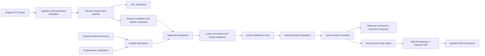

# Architecture and interface decisions

The HTTP receiver, dispatcher, reply helper, and Web API client are deep modules: each hides substantial protocol behavior behind a small interface. The seams are exercised by production adapters and local test adapters.

## Runtime responsibilities

- `Http\Receiver` verifies the original bytes, handles challenge responses, rejects unimplemented payload families, forwards retry metadata, and emits the inline acknowledgement outcome.
- `App` owns matching, global/listener sequencing, handler invocation, error aggregation, and initial response cardinality. Ordinary event handlers return no initial response; commands and interactions must return exactly one response across matching listeners. `AcknowledgementValidator` enforces the response family and source-specific wire shape.
- `Authorizer` resolves an immutable authorization source before middleware. `InstallationAuthorizer` selects the workspace/Grid bot grant and the requesting user's grant. `TokenRotator` updates credentials under the installation store's atomic update seam; OAuth flow, storage, and refresh share the same immutable installation value.
- `Installer` handles browser-bound, one-time state and OAuth v2 exchange behind a small begin/complete interface. The Tempest controller translates its typed outcomes to HTTP responses. The default state and installation adapters use protected file storage; memory adapters support tests.
- `ConversationStore` hides serialization, expiry, and atomic updates behind immutable keys/records. Memory, file, and SQLite adapters cross the same seam. `DeliveryContext` derives canonical installation/channel/root identities; context capabilities load one delivery snapshot and refresh it after explicit writes. State is separate from installation credentials.
- `Integration\BoltDiscovery` converts method attributes to cacheable descriptors. Production uses Tempest's existing discovery cache; runtime closures are ordinary bootstrap registrations and are not serialized.
- `Reply` hides channel, user, parent-thread, and response-URL selection. Missing context fails explicitly, including channel replies from a global shortcut. It does not contain arbitrary application services or mutate payload values.
- `WebApi\Client` hides request serialization, token selection, typed result decoding, response-URL delivery, streaming multipart bodies, bounded retries, and pagination. Upload helpers hide reservation/transfer/completion behind immutable upload values and preserve partial progress on failure. Response URLs receive no bot bearer token. Its external seam is PSR-18, which tests replace with a recorded transport.

## Deliberate differences from Bolt JS

The target is capability and protocol parity. PHP source compatibility with JavaScript is not meaningful.

1. Handler methods receive readonly payload objects and narrow reply capabilities. Container-resolved application dependencies belong in constructors.
2. Registration methods are chainable. Attribute and fluent registrations feed the same descriptor representation.
3. Commands and interactions return a response value: `CommandResponse`, `ActionResponse`, `ShortcutResponse`, `OptionsResponse`, or `ViewResponse`. Wrong-family, missing, and multiple responses fail clearly.
4. HTTP execution is inline and response emission is buffered. Processing must fit Slack's three-second deadline. The playground explicitly persists slow work; framework-wide durable execution is being designed separately from in-process concurrency.
5. Matching listeners run sequentially. Global middleware runs once. Errors from matching listeners are collected rather than losing later listeners after an earlier failure. An Amp-backed Socket Mode transport does not make handlers or the default PSR-18 HTTP client non-blocking.
6. Reply helpers derive a thread root from `thread_ts ?? ts`. Outbound message factories make block fallback text explicit.
7. Known event/payload mismatches and duplicate registrations fail at boot. Unsupported capabilities remain visible in the inventory without being silently acknowledged.
8. Pagination uses PHP generators; immutable builders use PHP 8.5 clone updates and `#[NoDiscard]`.
9. Interaction selectors preserve Bolt's scalar and constraint-object semantics. Per-field regex captures live on the immutable delivery; raw payloads preserve future Slack fields. Typed options adapt their wire format for legacy sources.
10. Installation credentials never replace the root container's client. A fresh Tempest credential scope resolves class handlers and constructor services for each authorized delivery. Payloads, authorization/source values, and reply capabilities support method injection. Preconstructed objects retain caller-supplied dependencies; custom containers must supply equivalent scope support before they can be used for authorization.
11. Conversation state retains Bolt's exact millisecond expiry and forgiving load semantics. PHP adds canonical tenant keys, thread records, native date inputs, portable JSON, and atomic transforms. Explicit writes update the shared delivery snapshot; separate deliveries remain isolated. Tempest defaults to durable files because ordinary PHP requests do not retain a shared in-memory application.

## Dependency baseline

The project runs on PHP 8.5 and locks Tempest 3.20.0. The original research baseline was 3.19.2, but Composer could not resolve its exact `nette/php-generator:4.2.1` requirement. Version 3.20.0, released on October 22, 2026, pins 4.2.3 and resolves successfully. Runtime integration is checked against the installed source, not presumed from older snippets.

The full Tempest foundation is intentional: discovery, container, console, HTTP routing, and configuration are product requirements. Slack's generated client uses PSR-18 directly to support form and JSON protocols without depending on Tempest's higher-level HTTP body conversion.

## Port order

HTTP interactivity, retained legacy families, OAuth installation/authorization, conversation/thread storage, and Socket Mode are implemented. SDK models, Block Kit builders, retries, and upload protocols are implemented against pinned sources. Work Objects, assistant-thread lifecycle/context/streaming, and custom-function input/completion runtimes are also implemented. Framework-wide durable execution, modern agent-session cancellation and release conformance remain open. See the [current inventory](research/codebase-inventory-2026-10-24.md), [parity map](research/api-parity.md), and [application/async research brief](research/application-and-async-brief.md).
