# Configure the Slack app

Verified in Slack's app-settings UI and against Slack's official documentation on **2 November 2026**. The screenshots show the existing Thunder Bolt development app; its enabled features are broader than the generated starter. Use the minimum permissions your application needs. No app settings or credentials were changed while capturing these examples.

Start with [Getting started](getting-started.md) to generate the PHP project. `bolt new` creates local code, environment examples and a manifest. It does not create a Slack app, install it, grant scopes or generate tokens.

## Choose delivery and authorization

These are independent choices:

| Choice | Slack configuration | Private application values |
| --- | --- | --- |
| HTTP delivery | Public HTTPS request URLs; signing secret | `SLACK_SIGNING_SECRET` |
| Socket Mode delivery | Enable Socket Mode; app-level token with `connections:write` | `SLACK_APP_TOKEN` |
| One-workspace bot authorization | Install the app and obtain its bot token | `SLACK_BOT_TOKEN` |
| OAuth installation authorization | Client credentials, HTTPS callback, installation flow and persistent store | `SLACK_CLIENT_ID`, `SLACK_CLIENT_SECRET`, `SLACK_OAUTH_REDIRECT_URI` |

The app-level `xapp` token opens a WebSocket. It does not authorize bot messages. For the starter's ordinary bot deliveries, supply an installed bot token or configure OAuth as well. OAuth still needs reachable HTTP installation/callback routes when event delivery uses Socket Mode. [Slack's Socket Mode guide](https://docs.slack.dev/apis/events-api/using-socket-mode/)

## Create or configure an app

1. Open [Your Apps](https://api.slack.com/apps) and select **Create New App**.
2. Select **From a manifest**, then **Continue**. The current dialog also offers **AI agent**, **Starter app** and **Blank app**; those are Slack templates, separate from the PHP `bolt new` command.
3. Select your development workspace and import the generated `slack-manifest.yaml` using Slack's JSON/YAML editor.
4. Review the requested capabilities before completing creation. Replace placeholder HTTPS URLs before using HTTP delivery. In an existing app, use **App Manifest** to review or update the equivalent configuration.

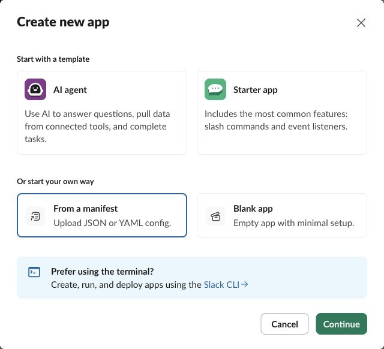

The generated starter only needs `app_mentions:read`, `chat:write` and the `app_mention` event. The large [playground manifest](../../examples/hello-bolt/slack-manifest.yaml) is a development reference, not a production permission baseline or a fully configured current Agent View/custom-function installation. [Slack app manifests](https://docs.slack.dev/app-manifests/)

Slack currently mixes `api.slack.com/apps/...` pages with `app.slack.com/app-settings/...` pages. Navigate by the sidebar names below rather than constructing URLs containing your workspace and app IDs.

## Install the bot and keep credentials private

For a single-workspace app:

1. Open **OAuth & Permissions** and review **Scopes → Bot Token Scopes**.
2. Add the two starter scopes above if importing the manifest did not already add them.
3. Open **Install App** and install into the development workspace. If Slack presents a new consent screen after configuration changes, review it before approving.
4. Obtain the **Bot User OAuth Token** from the installation/OAuth page and put it in your application's private `.env` as `SLACK_BOT_TOKEN`.

Bot credentials normally start with `xoxb-`; user credentials normally start with `xoxp-`. Rotating tokens can use other prefixes. Do not put either token in the manifest or commit them. `SLACK_BOT_TOKEN` needs the bot credential, not an app-level token or a signing secret. [Slack token types](https://docs.slack.dev/authentication/tokens/)

From your generated app, run:

```sh
php bolt auth:verify
```

For a static-token installation, use the returned `user_id` and `bot_id` as `SLACK_BOT_USER_ID` and `SLACK_BOT_ID`. Verification is explicit; `doctor` only checks local prerequisites. OAuth apps resolve identity from their stored installations instead.

Invite the bot to a test channel, then mention it. A successful installation alone does not grant access to every private channel.

## HTTP delivery

1. Open **Basic Information → App Credentials** and copy the **Signing Secret** into `SLACK_SIGNING_SECRET`. The old **Verification Token** is not used for signature verification.
2. Start `php bolt serve` for local development. The default address is `127.0.0.1:8000`; expose it through trusted public HTTPS, or use your PHP production host with `public/index.php` as its entry point.
3. Open **Event Subscriptions**, enable events, and set **Request URL** to your public `https://your-host.example/slack/events`.
4. Keep the endpoint running while Slack verifies the URL challenge. The framework handles the challenge and signed raw-body validation.
5. Under **Subscribe to bot events**, add `app_mention`. Add other events only when handlers need them.
6. Save the page, then complete any reinstall Slack requests.

Use the same `/slack/events` endpoint in each HTTP interaction setting that your app uses:

| Slack setting | When to configure it |
| --- | --- |
| Event Subscriptions → Request URL | Events such as `app_mention` |
| Interactivity & Shortcuts → Request URL | Buttons, shortcuts and modal submissions |
| Interactivity & Shortcuts → Options Load URL | External select options requested from your application |
| Slash Commands → each command's Request URL | Each slash command you create |

A single Event Subscriptions URL does not automatically configure the other surfaces. Preserve the raw HTTP body through proxies/middleware; changing it before signature verification breaks verification. [Signed requests](https://docs.slack.dev/authentication/verifying-requests-from-slack/), [HTTP event URLs](https://docs.slack.dev/apis/events-api/using-http-request-urls/)

## Socket Mode delivery

1. Open **Socket Mode** and enable **Enable Socket Mode**.
2. Open **Basic Information → App-Level Tokens → Generate Token and Scopes**.
3. Give the token a useful local name, choose **Add Scope → connections:write**, then generate it.
4. Store the generated credential privately as `SLACK_APP_TOKEN`.
5. Continue configuring event subscriptions, interactivity, shortcuts and slash commands. Their handlers still need these Slack-side registrations; only the transport changes.
6. For ordinary bot events/messages, install the app with the bot scopes it needs, or complete OAuth. Start `php bolt socket:serve` from the PHP app.

A function-only app can instead use the app-level token with `attachFunctionToken=true` (the default): each `function_executed` delivery supplies its own scoped workflow credential. That narrow path does not authorize ordinary bot events or messages. See [custom workflow functions](advanced-slack-features.md#custom-workflow-functions).

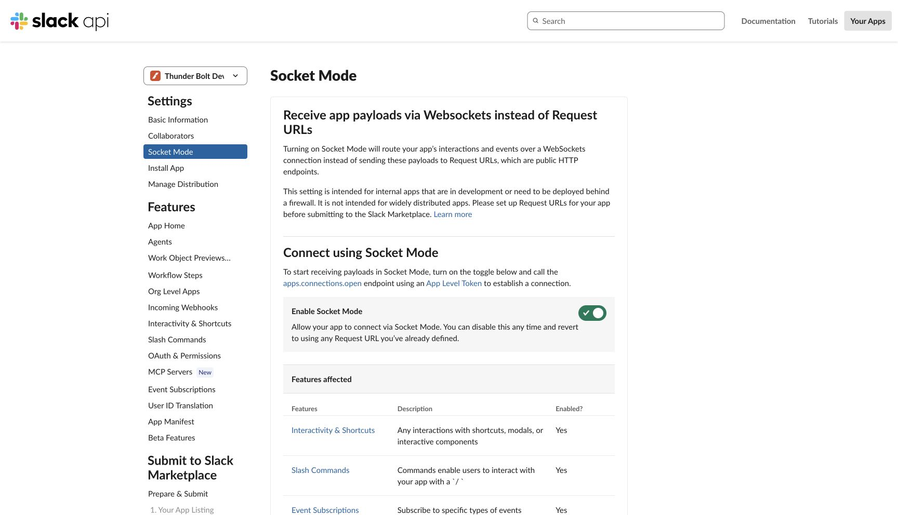

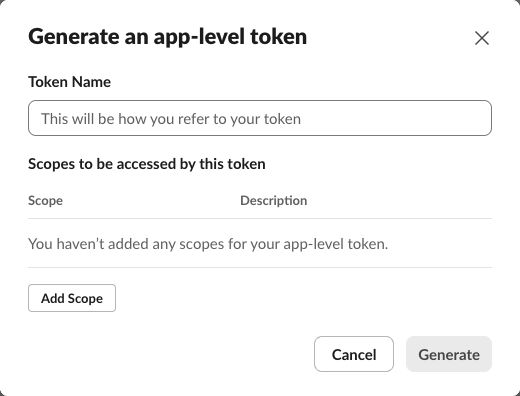

With Socket Mode enabled, Slack's Event Subscriptions and Interactivity screens explicitly say that a Request URL is not needed. Slack sends those payloads over the socket instead. Public HTTP event forwarding is not a second parallel delivery path. Socket Mode currently cannot be used for public Slack Marketplace listings. [Socket Mode](https://docs.slack.dev/apis/events-api/using-socket-mode/)

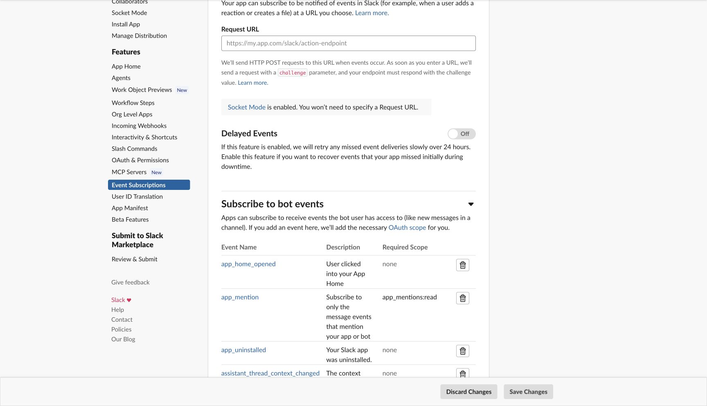

The screenshot's bot-event list belongs to the broad development app. A starter should begin with `app_mention`, not every event shown in the example.

For static-token workers, `php bolt socket:serve --verify-token` explicitly verifies and hydrates bot identity before connecting. OAuth workers instead need a stored installation; a nonempty client ID/secret does not prove the app is installed.

## Buttons, shortcuts, selects and modals

Open **Interactivity & Shortcuts**. In HTTP mode enable interactivity and enter its Request URL. With Socket Mode enabled, the screen shows the equivalent socket-routing notice.

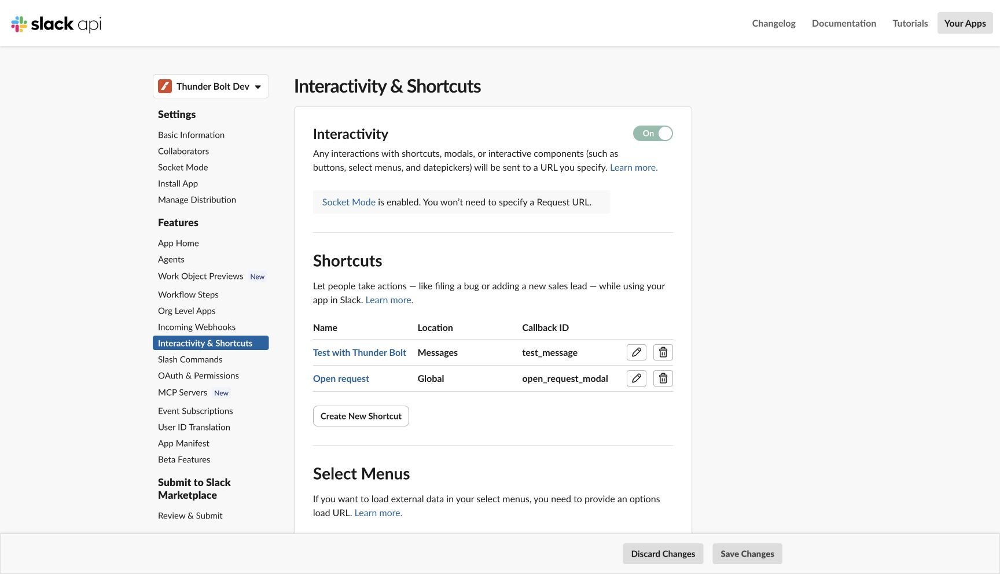

A button's `action_id` routes to its PHP action listener; you do not register every button in Slack's settings. A modal's `callback_id` routes its submission to a view listener. Global/message shortcuts do need entries under **Shortcuts → Create New Shortcut**, with callback IDs matching the PHP handlers. External selects can use an Options Load URL in HTTP mode; static selects do not need one.

Return the appropriate response promptly—Slack generally expects interaction acknowledgements within three seconds. Queue slow work explicitly instead of holding the initial response open. [Interactivity](https://docs.slack.dev/interactivity/handling-user-interaction/), [PHP handler guide](building-apps.md)

## Slash commands

1. Add the `commands` bot scope under **OAuth & Permissions**.
2. Open **Slash Commands → Create New Command**.
3. Enter the command, including its leading slash, such as `/hello`, plus a short description and optional usage hint.
4. In HTTP mode set **Request URL** to `/slack/events` on the public host. In Socket Mode the form states that this URL is unnecessary.
5. Save the command and reinstall if Slack requests it. Match the same slash-command name in the PHP listener.

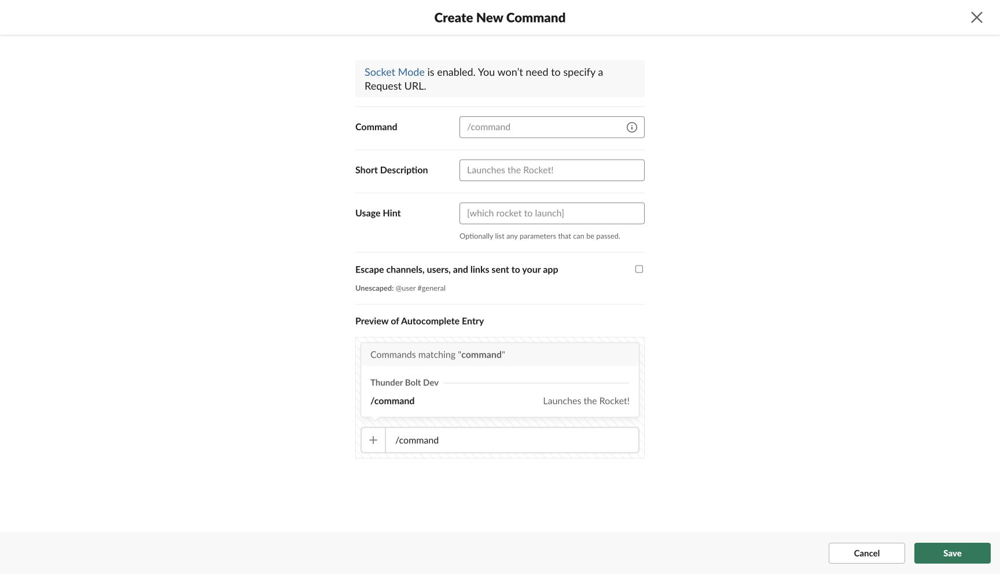

The screenshot intentionally shows an unsaved blank form. Slack's slash commands do not run inside message threads; use a message shortcut or message listener for thread-specific entry points. [Slash commands](https://docs.slack.dev/interactivity/implementing-slash-commands/)

## OAuth callbacks and rotation

Use this path for installation-based authorization across workspaces rather than manually copying one bot token.

1. Open **Basic Information → App Credentials** for the Client ID and Client Secret.
2. Set `SLACK_CLIENT_ID`, `SLACK_CLIENT_SECRET` and `SLACK_OAUTH_REDIRECT_URI` in the private environment.
3. Under **OAuth & Permissions → Redirect URLs**, select **Add New Redirect URL**. Enter the exact public HTTPS callback, normally `https://your-host.example/slack/oauth_redirect`, then **Save URLs**.
4. Configure the application's requested bot/user scopes and persistent private installation store.
5. Start the HTTP host and open `/slack/install` to begin the framework's state-protected installation flow. Slack returns to `/slack/oauth_redirect`; the framework stores the installation after validating the flow.

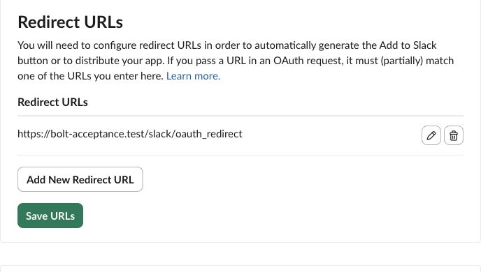

The screenshot uses an isolated local acceptance hostname. Use your own externally reachable HTTPS callback for a remote user/workspace installation. Slack's configured callback and the application's `redirect_uri` must agree; when multiple redirects are registered, authorization and code exchange must use the same selected redirect. [OAuth installation](https://docs.slack.dev/authentication/installing-with-oauth/)

Thunder Bolt persists and rotates OAuth installation **bot/user** credentials. Slack separately offers rotation for **app-level** tokens on Basic Information. The framework does not yet store or refresh rotating `xapp` credentials, so do not enable app-level rotation for a worker using only `SLACK_APP_TOKEN`. Enabling rotation is irreversible. See [OAuth and authorization](../oauth-and-authorization.md) for installation-store and refresh behavior, and [Slack's rotation guide](https://docs.slack.dev/authentication/using-token-rotation/) for the Slack-side decisions.

## App Home

For a Home dashboard such as Boltling:

1. Open **App Home → Show Tabs** and turn on **Home Tab**.
2. Subscribe to `app_home_opened` in Event Subscriptions and publish the view with `views.publish` from its handler.
3. Enable interactivity for the Home view's buttons.
4. Enable **Messages Tab** and **Allow users to send Slash commands and messages from the messages tab** if you want people to send messages there. Add `message.im` and `im:history` if the app listens to those messages.

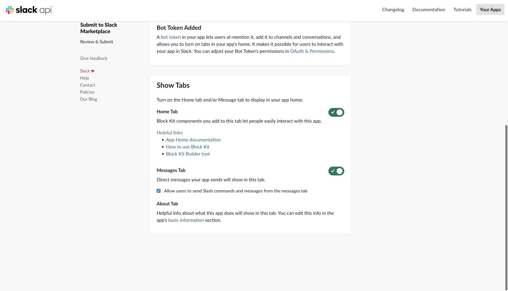

Opening the tab does not automatically render your PHP view. The application must publish it, and updating a channel message does not update the Home view. [App Home](https://docs.slack.dev/surfaces/app-home/)

## Agents and assistant compatibility

The current sidebar entry is **Agents**. Its **Agent experience** control gives the app an agent entry point and conversational surface; the page also exposes suggested prompts.

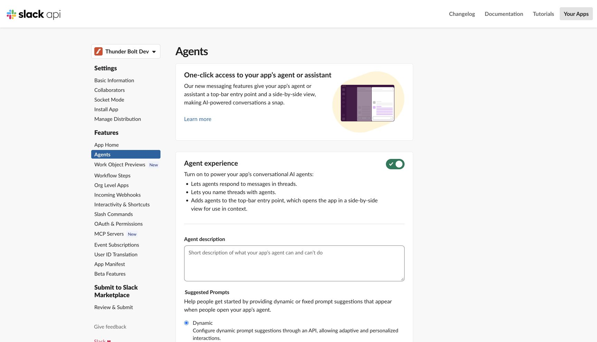

Thunder Bolt supports the retained `assistant_thread_started` / `assistant_thread_context_changed` lifecycle, DM handlers and session status/title/stop helpers. Slack's newer Agent guidance also uses Agent View configuration and `app_context_changed`. The generic event router can receive that event, but the assistant lifecycle does not automatically interpret it. The playground manifest does not provide a complete current Agent View configuration.

For a current Agent integration, use the event/capability requirements in [Slack's developing-agents guide](https://docs.slack.dev/ai/developing-agents/) and validate the target workspace's availability. Typical events include `message.im`, `app_home_opened`, `app_context_changed`, `agent_session_stopped` and `agent_session_title_changed`, with scopes such as `assistant:write`, `chat:write` and `im:history`. Do not assume the **Slack MCP Server** toggle is required for the framework's ordinary Web API tools; that is a separate integration.

See [Advanced Slack features](advanced-slack-features.md) for the distinction between implemented helpers and application/provider integration. [Slack's Agent updates](https://docs.slack.dev/changelog/2026/08/20/agent-updates/)

## Workflow functions

The current menu is **Workflow Steps**. A PHP `#[SlackFunction(...)]` listener does not register a Workflow Builder step by itself.

1. Open **Workflow Steps** in an eligible development workspace. Resolve its prerequisites first: the remote-runtime **Update settings** control configures `settings.function_runtime: remote`; subscribe to `function_executed` under **Event Subscriptions**. Satisfy Slack's org/step eligibility requirements.
2. Once **Add Step** is available, define the callback ID and typed inputs/outputs in Slack's Workflow Steps/manifest configuration.
3. Match the callback ID in PHP, then explicitly complete or fail the execution using its scoped helper.
4. Add the step to a test workflow in Workflow Builder and exercise its success/failure paths.

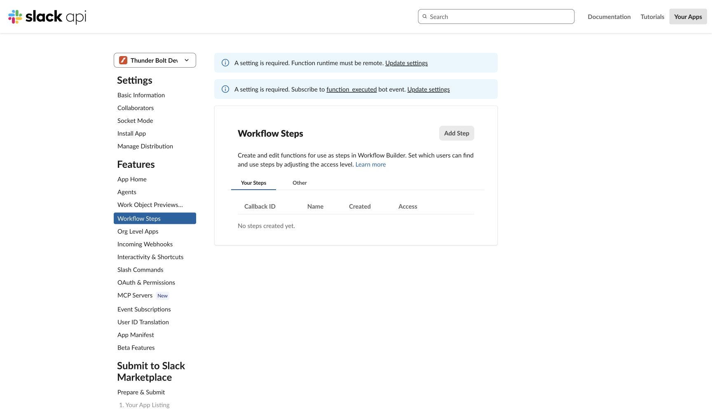

The screenshot shows missing configuration prerequisites; it is not a plan-upgrade screen. Slack documents custom workflow-step development as unavailable on the Free plan. The playground's function definition is not a claim of a completed live installation in every workspace. [Workflow steps](https://docs.slack.dev/workflows/workflow-steps/)

## Work Objects, unfurls and metadata

Open **Work Object Previews** and configure the supported entity types. For the task example the type is `slack#/entities/task`.

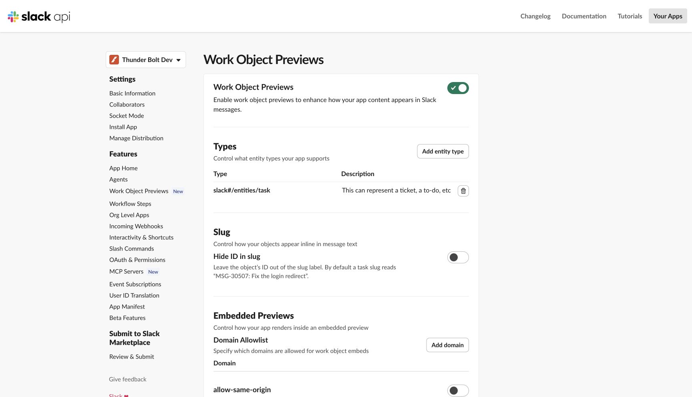

For link-triggered Work Objects, add `links:read`, `links:write`, `link_shared` and your domains under **Event Subscriptions → App unfurl domains**. Add `entity_details_requested` and, for comments, `entity_comments_requested`; enable interactivity for comment actions. Authorize every external record and comment operation in application code—an external object ID or URL is not permission to access it. [Work Objects](https://docs.slack.dev/messaging/work-objects-overview/), [comments](https://docs.slack.dev/messaging/work-objects-comments/)

Message metadata is separate. Sending metadata does not subscribe the app to metadata events. If you need `message_metadata_posted`, `message_metadata_updated` or `message_metadata_deleted`, add those events and matching `metadata_subscriptions` entries under `settings.event_subscriptions`. The starter/playground manifests do not configure them automatically, and inbound metadata events use the generic event payload. [Message metadata](https://docs.slack.dev/messaging/message-metadata/)

## Check the installation

After changing scopes or other installation-affecting settings, save changes and follow Slack's reinstall/consent prompt. Revisit the generated manifest and environment after changing delivery mode; switching the PHP start command alone does not change Slack's transport.

```sh
php bolt doctor --format=json
php bolt listener:list
# Static-token authorization only:
php bolt auth:verify
# Once Socket Mode intake and any job workers have started:
php bolt status --format=json --require=socket,jobs
```

`doctor` checks local configuration; `auth:verify` makes a Slack request for a static token; `status` reads shared local observations. Require only the worker roles the app actually runs. None of these commands creates missing Slack-side subscriptions, grants scopes, or installs the app for you.

If an app gets no events, check delivery mode, installed scopes, selected bot events, channel membership and whether the HTTP endpoint/socket process is reachable. For signature failures, compare the exact signing secret and raw request body. For an installed app with no bot identity, verify that you supplied its bot token rather than its signing secret or app token. [Troubleshooting](testing-security-troubleshooting.md)
