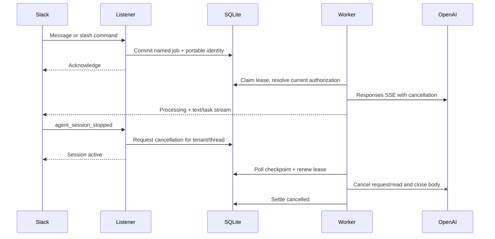

# Agent sessions and durable AI

Implemented 24 October 2026. This is an integration note; longer guides belong on the future docs site.

## Interface

```php
$thread->session()->processing(title: 'Investigating');
$thread->session()->rename('A clearer title');
$thread->session()->suspended(); // waiting for input
$thread->session()->active();
$thread->session()->closed();

$thread->sayStream()
    ->append('Here is what I found.')
    ->finish(AgentSessionStatus::Active);
```

`Session` pins channel and root timestamp to `ThreadIdentity`. Existing assistant-thread loading text, title and prompt methods remain compatible. `MessageStream::stop(Block ...$blocks)` still works and finishes as active. `finish(AgentSessionStatus, Block ...$blocks)` permits explicit lifecycle completion. Stop events are typed; `Session::stopped($event)` verifies the thread before settling status. Applications choose which work to cancel.

`append()` encodes text as markdown chunks internally. Slack fixes a stream's wire mode on its first call and rejects mixing the top-level `markdown_text` argument with `chunks` later. Consistent chunks allow ordinary text and task progress to share a stream. This was verified in the live tour after its first run exposed `streaming_mode_mismatch`.

## Execution



The demo stores only named job data and portable installation/channel/thread/user identity in SQLite. Credentials, HTTP clients, response URLs and trigger tokens are not job payloads. History remains in the conversation adapter, read under a per-thread lock when execution starts. AI uses one attempt by default; operator recovery is explicit because repeating a model/tool turn may repeat side effects.

Slack may have already stopped the timestamps in `streaming_message_ts`; the array may also be empty. The stop event still means cancel non-stream work. Session state does not change automatically. User title changes are application state and must survive subsequent replies.

## Limits and evidence

Cancellation is cooperative. The demo bridges persisted state to Amp cancellation during OpenAI connection and body reads and checks before tools. It cannot undo completed tool effects, forcibly interrupt synchronous PHP or guarantee an arbitrary application HTTP transport is cancellable. Slack calls have bounded timeouts. A process crash can leave Slack processing until its timeout or another explicit transition; the durable attempt becomes uncertain rather than silently rerunning.

Focused tests cover session states/identity, streaming completion, durable tour intake and child context, tenant/thread cancellation, and AI cancellation. Full generated SDK coverage and local fixtures do not establish every live Slack contract. `/kickensink` (alias `/kitchensink`) exercises the integration with a real durable stream and buttons for AI, Boltling, work items and a typed modal. It does not automatically execute terminal commands or paid-plan workflows.

Validation: 527 PHPUnit tests / 3,420 assertions; Mago formatting, lint and analysis pass with no errors (advisories remain); seven generator-tooling tests and generated ownership checks pass. The live development workspace accepted both tour command names and session event subscriptions. A completed tour, a cancelled tour attempt, a real AI web search with citations, and the details modal were exercised through Slack. The cancelled attempt settled as `cancelled` with `JobCancelled` and one attempt.

Resolved 25 October 2026: the generic SDK's JSON POST to `conversations.replies` returned missing-field errors in the live probe. Conversation reads now use their documented GET/query contracts. The opt-in live suite verifies the Slack-metadata adapter's save/fresh-read round trip and message preservation; [transport audit](web-api-transport-conformance.md). This scoped fix does not establish exhaustive Web API compatibility.

## Primary sources

- [Slack agent sessions](https://docs.slack.dev/ai/agent-sessions/): lifecycle, Stop, title ownership and streaming integration. High confidence.
- [Slack streaming mode constraints](https://docs.slack.dev/reference/methods/chat.startStream/): text/chunk consistency, total limits and stream timeouts. High confidence.
- [OpenAI Responses streaming](https://developers.openai.com/api/docs/guides/streaming-responses): typed SSE lifecycle and text/tool events. High confidence. This demo uses foreground HTTP streaming; it does not use a background-response cancellation endpoint.
- [Amp cancellation](https://amphp.org/amp#cancellation): cooperative cancellation and transport tokens. High confidence.

Design choice: preserve the Bolt assistant-thread interface, add a small thread-bound session interface, and keep job cancellation policy in the application. This avoids tying Slack session control to a particular queue or model provider.
