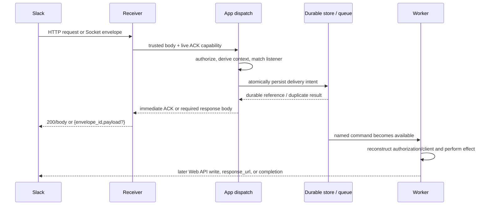
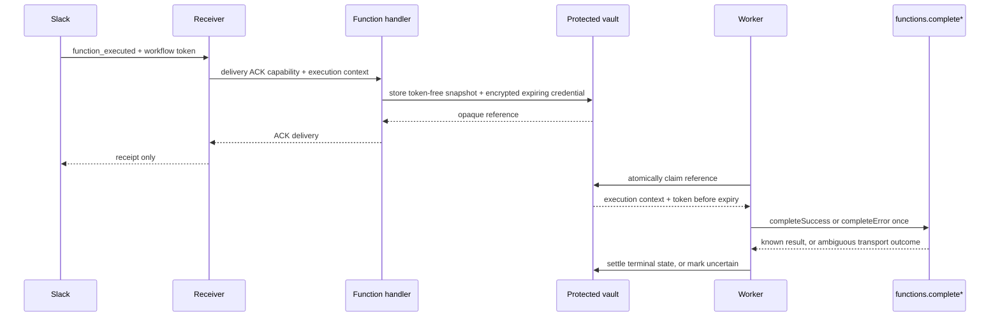

# Bolt application, acknowledgement, and deferred-work boundary

Research date: 2026-10-24. This note compares the pinned Bolt JS `v5.1.0`
source with current Slack documentation and the existing Thunder Bolt runtime.
It is a design input, not an implementation plan.

## Decision summary

🟢 Keep `Thunder\Bolt\App` a Slack **dispatch and composition** object, not a
general application kernel or queue facade. Tempest remains responsible for
boot, discovery, DI, command dispatch, workers, scheduling, and lifecycle.

🟢 Make durable work an explicit application command. Persist a small,
token-free delivery snapshot and idempotency key *before* returning the Slack
acknowledgement, then let the application dispatch one named command. Do not
turn every listener into an implicitly queued listener.

🟢 Model three independent outcomes: transport acknowledgement, user-facing
business reply, and workflow terminal completion. Success in one does not prove
success in either of the others.

🟡 A protected, short-TTL credential handoff is only justified for a custom
function whose worker is guaranteed to run before its workflow token expires.
The result of a completion write can be uncertain; retain that record for
inspection rather than retrying blindly.

## Terminology and ownership

| Term | Owns it | Meaning |
| --- | --- | --- |
| Receiver | HTTP / Socket Mode adapter | Verifies/parses a live delivery, supplies the one-shot acknowledgement transport, and starts/stops the transport. |
| Bolt/Thunder `App` | Slack integration | Authorizes a delivery, derives context and a client, runs middleware and matching listeners, and interprets the listener's immediate acknowledgement result. |
| Acknowledgement | Slack delivery protocol | `200`/body over HTTP or an `envelope_id` reply over Socket Mode. It says only that this delivery was received. |
| Business reply | Application / Slack Web API | An immediate command/action body, `response_url`, `chat.*`, modal operation, or assistant message. It is a separate write with its own outcome. |
| Function completion | Slack workflow API | `functions.completeSuccess` or `functions.completeError` transitions a custom workflow step. It is neither the delivery ACK nor a general message reply. |
| Deferred command | Application + Tempest | A named, serializable intent owned by the application. Its storage, worker, retry, cancellation, and observability semantics come from the configured host, not Bolt. |

### What Bolt JS actually does — verified, high confidence

The `Receiver` interface is intentionally small: `init(app)`, `start()`, and
`stop()`. A receiver gives `App.processEvent()` a parsed body, retry metadata,
custom properties, and an `ack` closure. Bolt's custom-receiver documentation
assigns parsing and acknowledgements to the receiver, then context and listener
dispatch to `App` ([receiver guide](https://docs.slack.dev/tools/bolt-js/concepts/receiver/)).

In the pinned source, `App` initializes a receiver last, delegates `start()`
and `stop()` to it, calls `authorize`, constructs context/client utilities,
auto-ACKs ordinary Events API events before listener execution, and waits on
all matching listener promises. The HTTP receiver holds an acknowledgement
timeout (normally 3001 ms; 5001 ms for `function_executed` in this release),
while the Socket Mode response ACK currently has no comparable timer. Neither
receiver persists listeners as jobs or supplies a worker/retry abstraction.
[`App.ts`](https://github.com/slackapi/bolt-js/blob/ffbe0b6c03a6b1e16b3d5d3c5c9a8ab3effcbc1d/src/App.ts),
[`HTTPReceiver.ts`](https://github.com/slackapi/bolt-js/blob/ffbe0b6c03a6b1e16b3d5d3c5c9a8ab3effcbc1d/src/receivers/HTTPReceiver.ts),
[`HTTPResponseAck.ts`](https://github.com/slackapi/bolt-js/blob/ffbe0b6c03a6b1e16b3d5d3c5c9a8ab3effcbc1d/src/receivers/HTTPResponseAck.ts),
[`SocketModeReceiver.ts`](https://github.com/slackapi/bolt-js/blob/ffbe0b6c03a6b1e16b3d5d3c5c9a8ab3effcbc1d/src/receivers/SocketModeReceiver.ts).

`async` in this JavaScript design is event-loop concurrency and completion
ordering within the live process; it is **not durable execution**. A Promise
does not preserve listener state across process death, a serverless freeze, or
a deployment, and Bolt has no persisted job record to resume it. Setting
`processBeforeResponse` only changes when the HTTP receiver sends the
acknowledgement (Bolt documents it for FaaS); it does not create a queue.

## Slack acknowledgement contract — verified, high confidence

Slack requires a response within three seconds for Events API HTTP deliveries;
it recommends an immediate 200 and a queue rather than processing/reacting in
the same process. Failure can retry with `x-slack-retry-num` and
`x-slack-retry-reason` ([Events API](https://docs.slack.dev/apis/events-api/)).
Actions, commands, and options must be ACKed, also within three seconds
([Bolt acknowledgement](https://docs.slack.dev/tools/bolt-js/concepts/acknowledge/);
[interactivity](https://docs.slack.dev/interactivity/handling-user-interaction/)).

Socket Mode makes the transport different, not the business contract: Slack
wraps the normal payload with a unique `envelope_id`, and the application ACKs
by writing that ID (plus an optional response payload) on the authenticated
WebSocket ([Socket Mode](https://docs.slack.dev/apis/events-api/using-socket-mode/)).



The arrow from worker to Slack is deliberately not an ACK. If the receiver dies
between writing the ACK and queue persistence, work is lost; if it dies between
persistence and ACK, Slack may redeliver. The persistence operation must use
the delivery key to make the latter path safe enough for the chosen effect.

## Payload families: what can wait and what cannot

| Incoming family | Immediate requirement | May be deferred after the immediate step? | Durable reply/caveat |
| --- | --- | --- | --- |
| `url_verification`, SSL check | Return the challenge / receipt now. | No useful listener work. | Do not enqueue protocol handshakes. |
| Ordinary `event_callback` (including messages and assistant events) | Empty 2xx / Socket envelope ACK. Bolt JS auto-ACKs ordinary events. | Yes, after a persisted intake record. | Use `event_id` where supplied as the Slack delivery key; do later `chat.*`/assistant calls with freshly resolved installation authorization. |
| Slash command | ACK now, optionally with the initial message body. | Yes. | `response_url` is an optional temporary response channel; Slack documents up to five uses in 30 minutes. A `trigger_id` is one-use and expires in 3 seconds, so opening a modal cannot wait. |
| `block_actions`, shortcut, message action | ACK now; return an immediate update only when that UI change is required. | Yes. | A `response_url`, if present, can carry later messages; global shortcuts do not necessarily have one. Persist a protected expiry-bound response channel only if the worker needs it. |
| `view_submission` | ACK now. Validation errors and `response_action` (`update`, `push`, `clear`) are part of this immediate response. | Only work that does not decide the required modal response. | Queue the accepted business operation after synchronous validation/persistence; do not queue a modal validation decision. |
| `view_closed` | ACK the close receipt now. | Yes, for cleanup/audit that is not needed to decide the close. | Do not pretend a later worker can re-open or alter the already-closed modal. |
| `block_suggestion` / external options | Return the requested options in the ACK. | Follow-on warming/audit work only. | The options themselves cannot be deferred: Slack is waiting for them to render the menu. |
| `function_executed` or function-scoped interaction | ACK the delivery; Bolt JS custom functions auto-ACK the event by default. | Yes, with a protected short-TTL execution handoff. | Eventually exactly one logical `complete`/`fail` transition is required unless the function intentionally waits for a later user interaction. ACK does not finish the workflow. |

The last row is an especially important split. Slack requires workflow steps to
finish through `functions.completeSuccess` or `functions.completeError`
([workflow steps](https://docs.slack.dev/workflows/workflow-steps/)). These
calls require `function_execution_id` and, respectively, schema-conforming
outputs or a human-readable error; they may report that the execution is no
longer running or cannot be found
([success](https://docs.slack.dev/reference/methods/functions.completeSuccess/),
[error](https://docs.slack.dev/reference/methods/functions.completeError/)).
They are business writes with an observable but potentially uncertain outcome,
not a reply to the inbound receiver.



## Current Thunder Bolt seams — verified, high confidence

`App::dispatch()` already constructs the right live unit: decoded payload,
authorizer result, token-selected Web API client, `AuthorizationSource`,
conversation/thread context, middleware, listener results, and an optional
credential-scoped child container. `InvocationScope::create()` deliberately
places the delivery's `Client` and `Authorization` into a new
`GenericContainer`; it is not a serializable service locator. See
[`App.php`](../../src/App.php),
[`InvocationScope.php`](../../src/Invocation/InvocationScope.php), and
[`Delivery.php`](../../src/Invocation/Delivery.php).

The two present transports are synchronous at the dispatch boundary:

- `Http\Receiver::handle()` calls `App::dispatch()` and only then emits its
  HTTP response. It warns at 2.5 seconds, but cannot send an ACK and continue
  listener execution in another durable worker.
- `SocketMode\Runner::dispatchEnvelope()` calls `App::dispatch()` and then
  writes the acknowledgement containing the `envelope_id`; after a failed
  acknowledgement write it deliberately does not dispatch again.

That is a sound baseline, but it means **"defer" currently means a listener
persists and submits an application command synchronously before the receiver
can ACK**. It does not mean any listener return value is automatically durable.
[`Http\Receiver`](../../src/Http/Receiver.php),
[`SocketMode\Runner`](../../src/SocketMode/Runner.php).

The hello example makes the boundary concrete. Its filesystem `Queue` has an
idempotency key and atomically moves a record from pending to running, but
never automatically replays a running record after a restart. It deliberately
prefers loss of an incomplete AI/terminal effect to an unbounded duplicate. It
therefore is **not** at-least-once, exactly-once, or a general production queue.
[`Queue.php`](../../examples/hello-bolt/app/Demo/Queue.php).

The example `FunctionExecutionVault` is the special credential path: it stores
a token-free execution snapshot, encrypts the workflow token, permits one
claim, expires it, and records ambiguous terminal writes as `uncertain`.
Slack workflow tokens are `xwfp-`, cannot be refreshed, and expire after 15
minutes or immediately on function success/error, whichever is earlier
([tokens](https://docs.slack.dev/authentication/tokens/)). This is the right
failure posture for the demo; it must not be generalized into a promise that a
durable worker can resume expired workflow credentials.

## A reconstructable deferred delivery

The durable record should contain only values that a worker can safely use to
rebuild its live execution, not `Delivery`, `Reply`, a `Client`, the Tempest
container, closures, or raw installation tokens.

| Persist | Reconstruct / do not persist | Why |
| --- | --- | --- |
| `deliveryKey`, transport, retry count/reason, receipt time | live ACK closure / HTTP request / Socket connection | An ACK is only valid in the original delivery. |
| event `event_id`; Socket `envelope_id` for observability; application-generated interaction key | Treat an envelope ID alone as a durable business idempotency guarantee | Socket Mode calls it unique, but the durable dedupe policy needs a Slack stable key or carefully scoped fingerprint. |
| payload type, selector/callback ID, validated business input, user/channel/thread IDs, event timestamp | arbitrary raw payload fields or derived PHP objects | Store the minimum domain input and correlation context; raw payloads can contain sensitive/irrelevant data. |
| team ID, enterprise ID, enterprise-install flag, app ID when needed, authorization source | bot token, scoped client, `InvocationScope` | At execution time call the configured authorizer again and create a fresh delivery scope/client. Installation state may have changed. |
| response target metadata with explicit expiry, if a later user reply needs it | `trigger_id` | Response URLs are sensitive temporary capabilities; a trigger expires in 3 seconds and can be used once. |
| function execution ID and an opaque protected credential reference | workflow token in a normal command payload | JIT workflow credentials require encryption, TTL, access control, and uncertain-write handling. |

### Proposed minimal interface — proposal, not implemented

Keep the core seam narrow and make the application choose its durable backend:

```php
/** Application-owned, serializable command; no Client, container, or token. */
final readonly class SummarizeMention
{
    public function __construct(
        public string $deliveryKey,
        public InstallationReference $installation,
        public string $channelId,
        public string $threadTs,
        public string $text,
    ) {}
}

interface DeferredDeliveryStore
{
    /** Idempotently persist the intent before the Slack ACK is emitted. */
    public function record(string $deliveryKey, object $command): DeferredReceipt;
}

// Listener: validate -> record -> return the required immediate acknowledgement.
$app->event('app_mention', function (Delivery $delivery, DeferredDeliveryStore $store): void {
    $store->record($delivery->metadata['deliveryKey'], new SummarizeMention(/* validated fields */));
});

// Worker: resolve InstallationReference afresh, make idempotent business writes,
// and publish any later Slack response through the appropriate capability.
```

`DeferredReceipt` need only distinguish `recorded` from `alreadyRecorded`; it
must not imply that a worker ran, that a reply was delivered, or that a remote
write is exactly-once. The host can then bridge `recorded` work to Tempest's
command bus, another queue, or an outbox without Thunder Bolt owning workers.

For function completions, make the distinct capability explicit instead of
adding the workflow token to `SummarizeMention`:

```php
interface FunctionExecutionVault
{
    /** Stores a token-free snapshot and protected short-lived credential. */
    public function store(FunctionExecutionContext $context): FunctionExecutionReference;

    /** Single claimant obtains an execution capability or nothing. */
    public function claim(FunctionExecutionReference $reference): ?ClaimedFunctionExecution;

    public function markUncertain(FunctionExecutionReference $reference): void;
}
```

The existing demo is a useful proof of this narrower model; a production
adapter additionally needs its own key management, tenancy isolation,
monitoring, expiry handling, and operator resolution for `uncertain` records.

## Why explicit commands beat queueing whole listeners

Queueing arbitrary listener invocations would need to serialize the matcher,
handler target, middleware order, raw payload, acknowledgement semantics,
reply utilities, container scope, authorization, cancellation, and every
response family. It would either delay non-deferrable option/modal/trigger
responses or silently change them into empty ACKs. It also creates an
ambiguous retry boundary: re-running a listener may duplicate a database
effect, message, modal call, response URL post, or workflow completion.

An explicit command gives the application a reviewable boundary: validated
data, one dedupe key, selected retry policy, selected cancellation policy, and
an effect-specific idempotency strategy. The receiver can acknowledge only
after that boundary is durable, while the worker is free to reauthorize and
use a fresh client.

### Uncertain writes

No local state machine can distinguish "the network failed before Slack got the
request" from "Slack performed the write but the response was lost." Retrying
`chat.postMessage` can duplicate messages; retrying a function terminal call
can encounter `execution_not_in_running_state`; retrying a non-idempotent
external write can charge twice. For effects without a provider idempotency
key or a safe read-after-write reconciliation, record `uncertain`, stop
automatic retries, and give an operator a correlation ID and inspected state.
The demo vault already follows this rule for function terminal calls.

## Recommendation and open questions

1. Do not introduce a Thunder Bolt `Application` base class or universal
   `async` listener attribute now. Improve composition/documentation around
   the existing `App`, Tempest discovery, and `socket:serve` command instead.
2. Add an opt-in, explicitly named deferred-intake adapter only after agreeing
   on a production persistence/outbox contract and a per-effect idempotency
   story. It should reject payload families requiring an immediate body rather
   than quietly queueing them.
3. Preserve three separate tests for every deferred feature: record before
   transport ACK, worker idempotency/reauthorization, and outcome of the later
   Slack/external write. Do not call that combination exactly-once.
4. Before public API work, decide which installation reference is stable for
   enterprise installs, whether encrypted response URLs are in scope, and how
   operations inspect/reconcile uncertain writes.

Unknown: Slack documents Socket Mode envelope IDs as unique, but this research
does not establish that a redelivery always reuses the same envelope ID. Treat
them as a transport/correlation value, not the sole durable dedupe key until
verified against the protocol. Likewise, the pinned Bolt JS receiver's
function-event timeout is an implementation detail, not a platform promise.
