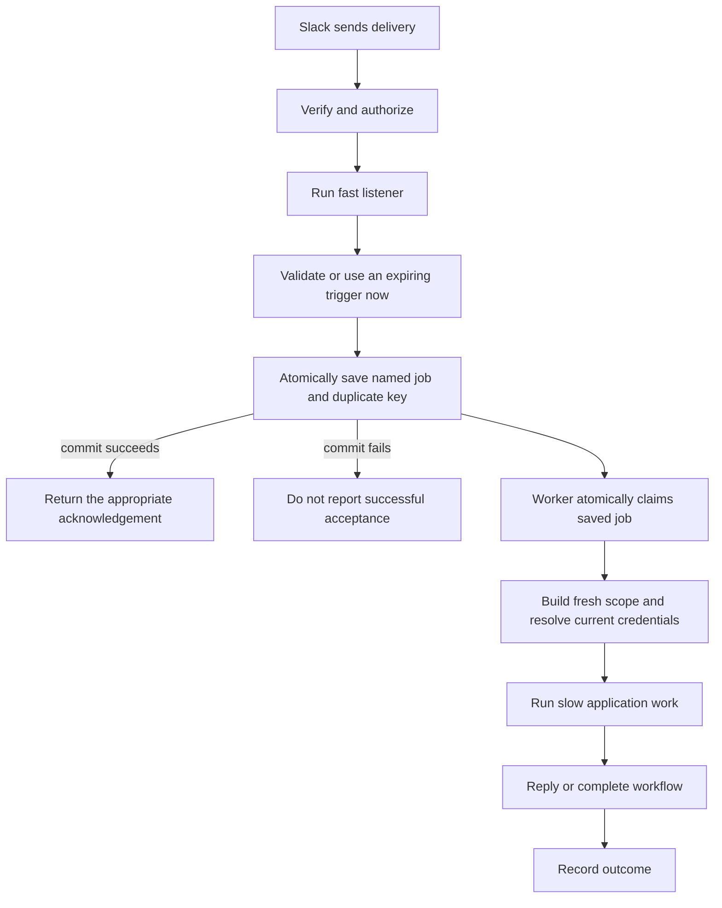
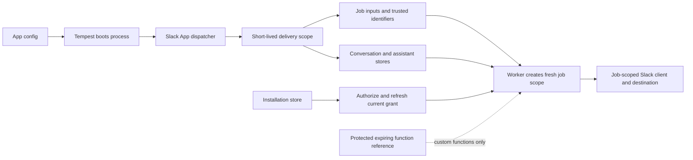
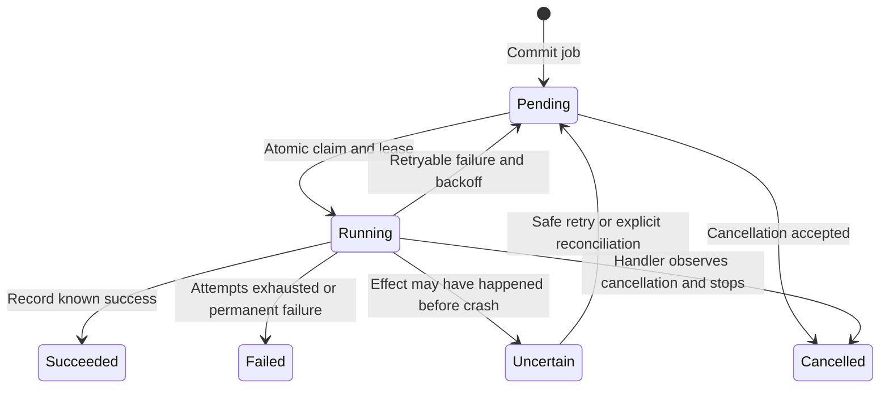
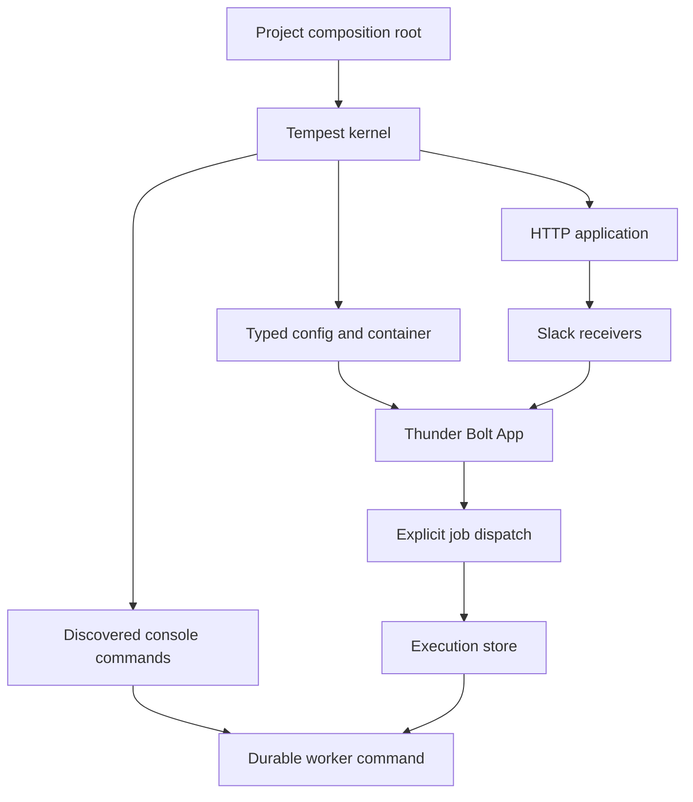

# Durable execution, context and application composition

## The problem this solves

A Slack delivery is an incoming message to our application: an event, a slash command, a button action or a modal submission. Slack expects a prompt transport acknowledgement. That acknowledgement confirms receipt; a later Slack message is the user-facing answer. A custom function has a third outcome: explicitly completing or failing its workflow step.

Today HTTP and Socket Mode run the matching handlers before acknowledging. A handler that spends 20 seconds calling a model can exceed the delivery deadline. Slack may retry even while the first handler is still working. A process crash can also lose unfinished work.

Durable execution changes the contract: **record the work successfully before acknowledging acceptance**. A worker finds that record independently of the original request. This does not guarantee a task succeeds, or that an external API effect happens exactly once. It gives the task a persistent identity and an observable lifecycle.

Acknowledgement and worker execution are independent after the commit: the worker might start before the acknowledgement reaches Slack. The invariant is persist-before-ack, not worker-starts-after-ack. A worker also needs an explicit deployment process; storing a job does not start that process for you.

## What stays immediate

| Incoming delivery | Immediate work | Work that can be deferred explicitly |
| --- | --- | --- |
| Mention or ordinary event | Validate, select installation, record job | Model calls, reports, external syncs, final message |
| Slash command | Return a command response, optionally saying work was accepted | Generate and post the result later |
| Button or shortcut | Return the required response; use a short-lived trigger to open a modal now if needed | Business task started by the interaction |
| External select options | Return choices | Refresh the cache beforehand or update another surface later |
| Modal submission | Validate fields and return errors/update/push/clear | Accepted business processing after validation |
| Custom function | Record work; acknowledge delivery | Business work plus explicit workflow complete/fail, within its credential constraints |

Whole-listener deferral must therefore be restricted to suitable event handlers. A universal `#[Async]` on any listener would hide meaningful differences and can make modal/options behavior incorrect.

## There are several kinds of context

"Context" is overloaded. These records have different contents, lifetimes and owners:

| Context | What it contains | What happens across the queue |
| --- | --- | --- |
| Application configuration | Paths, chosen adapters, Slack app settings, transport configuration | Boot again in the worker; resolve through the host container |
| Delivery identity | Installation/workspace/org, user, channel, known thread root, event/function/job identity | Persist the minimum trusted identity needed to reconstruct the task |
| Conversation/thread state | Application data explicitly saved for a channel or thread | Keep in the existing `ConversationStore`; read fresh when work executes |
| Assistant focus | The Slack context associated with an assistant thread | Continue using `ThreadContextStore`; it is not automatically model history |
| Authorization | Current installation grants, refreshed token and authorized client | Persist an installation reference; resolve authorization again at execution time |
| Workflow credential | Temporary token tied to a particular function execution | Protected, expiring credential reference; not an ordinary reusable installation token |
| Worker attempt | Claim owner, lease, attempt, deadline and cancellation request | Owned by the execution module, not conversation state |
| Correlation | Incoming delivery ID, job ID and attempt ID | Carry safe identifiers for diagnostics; keep distinct retry identities |

Do not serialize `Delivery`, `Reply`, `Client`, a container, a closure capturing services, or a conversation snapshot and hope it remains valid. They carry live behavior, credentials or stale state. A job is a named operation plus its explicit data. Reauthorization can legitimately fail if the app was uninstalled after enqueue; that should become an observable job outcome.

The current `Delivery` does not yet provide a unified durable receipt ID. Events API `event_id`, Socket Mode envelope IDs and custom-function execution IDs have different meanings. A future receipt/context value must preserve verified source identity and namespace duplicate keys by tenant and operation; hashing an entire mutable delivery is not a substitute.

## Async, parallel and durable mean different things

| Mechanism | Useful for | Survives the original process? | Important constraint |
| --- | --- | --- | --- |
| Ordinary inline PHP | Fast validation and responses | No | Blocks the handler while it waits |
| Amp fibers and non-blocking I/O | Overlap independent network waits | No | Blocking calls still block the process |
| Child processes | Parallel CPU work or isolation | Not a durable acceptance guarantee | Need process lifecycle, supervision and resource limits |
| Persisted jobs plus workers | Slow work with a persistent identity and recovery | Yes, within storage/deployment guarantees | Retries and uncertain effects require explicit policies |

These compose: a durable worker can run several non-blocking API calls concurrently. Concurrency can make a task finish faster; durable storage lets a different process find accepted work after a restart.

A local PHP 8.5/Amp experiment used three synthetic 100 ms waits: sequential non-blocking waits took **313.0 ms**; concurrent non-blocking waits **106.7 ms**; blocking `usleep()` wrapped in Amp futures **314.1 ms**. These are illustrative timer measurements, not a framework throughput benchmark. Amp's [architecture](https://amphp.org/architecture) documents the same cooperative-scheduling constraint. Our Socket Mode transport uses Amp, while the default Slack Web API and model calls currently use synchronous PSR-18 transports. End-to-end concurrency needs compatible I/O and fresh per-task scopes, not just futures around existing code.

## What happens when a worker crashes

A lease is a temporary claim: it prevents two healthy workers from taking the same attempt. Expiry is a recovery signal, not proof the old worker stopped. A heartbeat and conditional completion help, but cannot reverse a Slack message already sent. If Slack accepted a message and the worker died before saving that result, blindly replaying the job can post it twice.

Recommended defaults: bounded retries for known retryable failures; no automatic repetition of uncertain, non-idempotent effects; a visible inspection/recovery path. Operations that are safe to repeat can opt into lease-expiry recovery. This favors truthful outcomes over an unsupported exactly-once promise.

Cancellation is cooperative. A running model stream or job must check a cancellation signal and stop its I/O/work. A Slack stop event alone does not terminate PHP or undo completed actions. Once durable jobs exist, agent-session stop events can target jobs by installation/channel/thread and close their streams/status consistently.

## How much application framework do we need?

Tempest already owns boot, environment/configuration, DI, discovery, console commands, HTTP routing and shutdown. Thunder's `App` owns Slack registrations, matching, delivery authorization, response validation and handler dispatch. The existing initializers connect these roles.

A broad Laravel-style base class is premature: it would duplicate the host and blur process-level application state with per-delivery state. A **small bootstrap builder** may be justified after the worker exposes real shared setup needs. It should delegate to Tempest, centralize paths/configuration and boot choices, and return the existing Slack `App`; it should not add another container or command-discovery system. Prefer composition over requiring every project to extend a base class.

For custom commands, the project already uses Tempest's `#[ConsoleCommand]`; `bin/bolt` retains discovered `App\` commands. For configuration, typed `*.config.php` objects already load through Tempest. For storage, existing `ConversationStore`, `InstallationStore` and assistant context-store interfaces already provide adapter seams. An execution store is a different responsibility and should not overload conversation storage.

## Recommendation and decisions

1. Start with **explicit named jobs**, a **SQLite execution store** and a **worker command**. Retain synchronous listener responses. Keep the execution interface transport-independent and permit future queue adapters.
2. Reuse Tempest's config, container, command discovery and handler conventions. Its experimental 3.20 async repository can transport references, but does not supply atomic claims, leases, retries or cancellation. Avoid two competing sources of job truth.
3. Keep uncertain external effects visible; do not silently replay every expired lease.
4. Add modern agent-session lifecycle and cooperative stop handling on that foundation. The generated SDK methods and typed events are separate from a complete execution/cancellation runtime.
5. Revisit a small bootstrap builder after one worker and one fresh project share actual setup. Do not add a broad application superclass now.

The pending user choice is explicit jobs versus deferred event listeners for the first execution interface. Both can eventually coexist; selecting the first keeps the initial interface and recovery contract understandable. API spellings in the per-system research notes are proposals, not shipped methods.

## Source reports

- [Research brief](application-and-async-brief.md)
- [Tempest 3.20 boot and async internals](tempest-application-async.md)
- [Laravel application, queues and concurrency](laravel-application-async.md)
- [Bolt JS application, acknowledgement and async behavior](bolt-application-async.md)
- [Slack acknowledgement semantics](https://docs.slack.dev/tools/bolt-js/concepts/acknowledge/)
- [Slack agent-session lifecycle and stop behavior](https://docs.slack.dev/ai/agent-sessions/)
