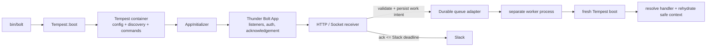

# Laravel application composition and async work

## Decision in one page

**Recommendation — do not add a Laravel-shaped `Application` kernel to Bolt.** Keep the
existing Tempest boot path as the host application composition mechanism, and, if Bolt needs
an ergonomic entry point, add a *thin, Bolt-specific composer* that returns the already-booted
`Thunder\Bolt\App`. Treat durable work as a separately configured, explicitly optional
facility with a small portable payload and a lease-based queue contract. Do not expose it as
Laravel-style closure concurrency, `defer()`, or an implicit listener return convention.

That recommendation is high confidence for composition and medium confidence for the eventual
queue adapter: the repository locks Tempest **3.20.0**, but no production Bolt queue API or
target back end has yet been selected.



The line from `R` to `Q` must complete *before* the acknowledgement says work was accepted.
The `T2` boot is intentional: a job is not a continuation of the receiver's PHP process.

## What Laravel's fluent Application builder actually is

**Verified (Laravel 12 source).** The stock `bootstrap/app.php` calls
`Application::configure(...)->withRouting(...)->withMiddleware(...)->withExceptions(...)->create()`.
`configure()` creates a full `Illuminate\Foundation\Application`; `ApplicationBuilder` is a
declarative staging façade around that application, not a replacement container or job system.
It registers standard HTTP/console kernels, queues providers/callbacks for the application boot
lifecycle, and returns the application unchanged from `create()`.

| Builder concern | What it stages in Laravel | Equivalent owner in this project |
| --- | --- | --- |
| `withKernels()` | Laravel HTTP and Artisan kernel bindings | Tempest's `FrameworkKernel` and `bin/bolt` |
| `withProviders()` | provider list read during boot | Tempest initializers/discovery/configuration; not a Bolt provider layer |
| `withRouting()` / `withMiddleware()` / `withExceptions()` | route provider, HTTP-kernel setup and exception handler | Tempest router + `AppInitializer` only where Bolt needs Slack-specific route behavior |
| `withCommands()` | console kernel command classes/paths | Tempest `#[ConsoleCommand]` discovery; `bin/bolt` then intentionally filters the exposed command set |
| `withBindings()` / `withSingletons()` | container registration callbacks | Tempest container bindings/initializers |

Laravel providers are a second, lower-level extension seam. Their `register()` phase should only
make container bindings; after every provider has registered, Laravel calls `boot()`, where
routes, listeners and other consumers may rely on all bindings being available. The builder
helps assemble these framework-wide phases; it does not make provider semantics disappear.

This distinction matters here. A fluent `BoltApplication::configure()` which also owns
configuration loading, discovery, routing, console commands, container bindings, and queue
drivers would silently create a second kernel beside Tempest. It would duplicate order-sensitive
work Tempest already performs: load `.env`, locate and load `*.config.php`, cache/boot discovery,
and register discovered console commands.

## Comparison with the locked Bolt/Tempest integration

**Verified (locked source).** `bin/bolt` obtains a `Tempest\Core\Tempest::boot()` container using
the Composer project as root and `.thunder-bolt` as internal storage. It reads the Tempest
`ConsoleConfig`, restricts commands to Bolt's deliberate allow-list plus discovered `App\` commands,
adds completion commands, then asks Tempest to execute the selected command. Tempest 3.20's
`FrameworkKernel` loads environment/configuration before discovery, and command discovery is
already part of the installed framework. Therefore commands and configuration are host-framework
concerns today, not gaps for a Bolt `Application` to fill.

**Verified (locked source).** `AppInitializer` is a Tempest `Initializer`: it adapts the existing
container into a Bolt `App`, provides defaults for the Web API client, Socket Mode connector,
OAuth stores/state, token rotation, and conversation store, then binds those chosen instances.
It deliberately permits an unconfigured app so discovery and safe commands such as `doctor` can
run. This is provider-like integration code, but it is neither a broad application kernel nor a
place to install a generic job runtime.

**Verified (locked source).** `InvocationScope` creates a new `GenericContainer` for each
authorized delivery and injects the delivery-specific Web API client and `Authorization`; it
does not put those credentials in the app container. `ExecutionContext` refuses serialization and
requires a protected reference for a queued function execution. Those are strong existing
boundaries which any queue must preserve.

```mermaid
sequenceDiagram
  participant Slack
  participant Receiver as Bolt receiver
  participant Store as queue/store
  participant Worker as worker process
  participant App as fresh Tempest/Bolt app

  Slack->>Receiver: signed delivery (may retry)
  Receiver->>Receiver: verify, dedupe/derive idempotency key
  Receiver->>Store: atomically record work intent
  Store-->>Receiver: accepted id
  Receiver-->>Slack: acknowledgement
  Worker->>Store: atomically claim + lease id
  Worker->>App: fresh boot; resolve handler
  App->>App: re-authorize / load durable state
  Worker->>Store: complete, or retry / dead-letter
```

## Queue and concurrency are different products

| Facility | Laravel mechanism | Useful promise | What it cannot promise for Bolt |
| --- | --- | --- | --- |
| In-process / child-process concurrency | `Concurrency::run()` serializes closures to a hidden Artisan CLI process; drivers are `process`, CLI-only `fork`, and test-oriented `sync` | Parallelism and collected results during the caller's lifetime | durable acceptance, retries, visibility leases, failure history, or an acknowledgement-safe handoff |
| Post-response concurrency | `Concurrency::defer()` runs closures after an HTTP response | Best-effort latency hiding | work survives request/process death; it is not a queue |
| Durable queue | queue connection/driver + independent `queue:work` workers | persisted work, configurable retries/timeout/failed-job operations | exactly-once external effects; visibility timeout expiry can cause a second execution |

Laravel's concurrency implementation also serializes closures and their return values. That is a
poor Bolt boundary: captured service instances, live clients, request data, and short-lived Slack
tokens are not a stable durable protocol. The CLI-only nature of `fork` further makes it an
unsuitable receiver default. A detached child process may be a future *worker implementation*
detail, never the durability mechanism.

The installed Tempest command bus should not be advertised as a durable queue without a new
adapter. `#[Async]` stores a serialized command and `command:monitor` polls pending commands,
spawning a `command:handle <uuid>` child. But `CommandRepository` exposes only
`store/getPendingCommands/findPendingCommand/markAsDone/markAsFailed`: no atomic claim, lease,
attempt counter, delay, backoff, timeout, or retry. Two monitors can observe the same pending
item before either deletes it; a crash after an external effect and before `markAsDone()` leaves
the item pending. Its repositories are still useful as a dispatch/handler-discovery seam, not as
the carrier of Bolt's delivery guarantee.

## Durability and isolation contract

Call the intended guarantee **at-least-once execution after durable acceptance**, never
"exactly once." A persisted job can run twice when the worker dies after an external effect but
before completion, or when its lease expires. Laravel documents the same class of issue: a queue
connection's `retry_after` releases a running job, and the worker timeout must be shorter than
that value or a job may be processed twice. Its uniqueness and `WithoutOverlapping` locks reduce
specific duplicate/concurrent work; neither makes an arbitrary Slack/Web API effect exactly once.

Minimum durable-store behaviour:

1. `enqueue()` atomically persists payload, key, attempt policy and an initial pending state.
2. `claim()` atomically reserves one eligible job with an owner and expiring lease—never
   `list()` then `find()`.
3. `complete()` is conditional on the lease/owner; `release()` increments attempt and schedules
   delay/backoff; exhaustion moves a diagnostic record to a dead-letter/failed state.
4. A reaper makes expired leases eligible again. This deliberately permits duplicate execution.
5. The handler supplies a stable idempotency key and makes side effects idempotent where the
   destination allows it. Serialize references and immutable input, not DI services, closures,
   live request objects, access tokens, or the `InvocationScope` container.

The worker should build a fresh project container per process and create a new narrow job scope
per claimed item. Re-fetch installation authorization/token through the configured store; do not
reuse the receiver's delivery-scoped client. For long-lived workers, reset or discard job-local
objects every item, bound memory/jobs/time, and restart on deployment. Laravel calls out the same
long-lived-worker static-state risk; Tempest's kernel has a `longRunning` reset path, but its use
must be verified in the eventual worker runner rather than assumed.

## Candidate, deliberately narrow interfaces

These are design sketches, not a proposed public API yet. They separate Bolt's envelope from a
back-end implementation and leave Tempest's command bus available as an optional handler adapter.

```php
interface WorkQueue
{
    /** Returns false only when the same idempotency key is already accepted. */
    public function enqueue(WorkEnvelope $work): EnqueueResult;

    /** Atomically leases at most one eligible item. */
    public function claim(WorkerId $worker, LeaseDuration $lease): ?LeasedWork;

    public function complete(LeaseToken $lease): void;
    public function release(LeaseToken $lease, RetryPlan $retry, \Throwable $error): void;
}

interface WorkHandler
{
    /** Fresh job scope; resolve authorization/state from safe references. */
    public function handle(WorkEnvelope $work): void;
}

final readonly class WorkEnvelope
{
    // schemaVersion, type, immutable payload, idempotencyKey, trace/delivery metadata,
    // attempt policy and a protected reference to any credential-bearing context.
}
```

At the Bolt listener seam, favour an explicit call such as
`$queue->enqueue(DeferredWork::fromDelivery(...))`, followed by the normal acknowledgement.
Do not let a listener's `null`, `Promise`-like value, `#[Async]`, or background closure implicitly
change acknowledgement semantics. A caller needs a clear branch when enqueue fails: return an
error/retryable response before Slack's deadline, or deliberately perform a documented
best-effort action.

### Dependency and naming guardrails

* **No generic `Application` name or global `app()` helper.** `Thunder\Bolt\App` already means
  Slack listener composition, while Tempest owns the actual application/container lifecycle.
  A name such as `BoltProject` or `BoltBootstrap` makes its limited role obvious.
* **No provider façade.** Let a project use Tempest `*.config.php`, discovery, container
  initializers and `#[ConsoleCommand]`. Bolt may expose a documented initializer/config object;
  it should not reimplement registration/boot phases.
* **No queue driver overloading.** A `sync` test driver, a `process` concurrency driver, and a
  durable queue back end have different failure semantics. Driver names must state which one they
  implement (`memory`, `sqlite`, `redis`, `sqs`, etc.), and the API should surface its guarantee.
* **No serializer trust boundary.** Both Laravel's and Tempest's default async paths serialize
  PHP objects. Accept only a typed/versioned Bolt payload from application code; avoid unserializing
  untrusted queue data, and encrypt/protect credential-reference storage.
* **Do not mix Slack retry with job retry.** Slack delivery retries can happen before or after an
  acknowledgement failure; job attempts happen after durable enqueue. Dedupe each layer with
  different identifiers and record their relationship for diagnostics.

## Recommendation and rollout order

1. Keep `bin/bolt`, `Tempest::boot`, `AppInitializer`, discovery, config and commands as the
   composition path. A small *optional* project bootstrap helper is reasonable only if it merely
   gathers Bolt configuration/listeners and returns the Tempest-resolved `App`.
2. First formalize a serializable `DeferredWork` envelope and explicit receiver handoff with
   idempotency/observability tests. Keep the initial adapter in-process only if the docs call it
   non-durable.
3. Before offering a durable mode, implement/test an atomic claim + lease back end (SQLite or
   Redis are distinct designs), retries/backoff/dead-letter records, two-worker contention,
   crash-between-effect-and-complete, expiry redelivery, and credential rehydration.
4. Adapt Tempest `CommandBus` handlers only behind `WorkHandler` after those semantics exist;
   do not have Bolt depend on Tempest's current async repository as its durable store.

## Evidence and confidence

### Primary external sources

* [Laravel 12 application bootstrap](https://github.com/laravel/laravel/blob/12.x/bootstrap/app.php)
  and [ApplicationBuilder source](https://github.com/laravel/framework/blob/12.x/src/Illuminate/Foundation/Configuration/ApplicationBuilder.php)
  — builder responsibilities. **Verified.**
* [Laravel service providers](https://laravel.com/framework/docs/12.x/providers) — provider
  registration/boot lifecycle. **Verified.**
* [Laravel queues](https://laravel.com/framework/docs/12.x/queues) — workers, retries, leases,
  timeouts, failure handling and overlap locks. **Verified.**
* [Laravel concurrency](https://laravel.com/framework/docs/12.x/concurrency) — isolated closure
  processes and `process`/`fork`/`sync` drivers. **Verified.**

### Locked local evidence

* [`bin/bolt`](../../bin/bolt),
  [`AppInitializer.php`](../../src/Integration/AppInitializer.php), and
  [`InvocationScope.php`](../../src/Invocation/InvocationScope.php) — current composition and
  per-delivery credentials. **Verified at locked Tempest 3.20.0.**
* `vendor/tempest/framework/packages/command-bus/src/{AsyncCommandMiddleware,MonitorAsyncCommands,HandleAsyncCommand,CommandRepository}.php`
  and repositories — async command bus limitations described above. **Verified at locked
  Tempest 3.20.0.**
* [`ExecutionContext.php`](../../src/Functions/ExecutionContext.php) — serializing live function
  context is rejected. **Verified.**

The proposed queue boundary, exact envelope fields, storage choice and worker reset mechanics are
**inferences/recommendations**, pending a selected deployment target and an end-to-end prototype.
