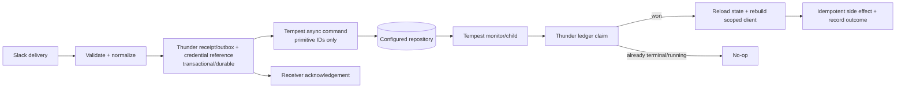

# Tempest application composition and async commands

## Decision in brief

**Reuse Tempest for boot, configuration, DI, discovery, console commands, and
the optional `CommandBus`; do not add a Thunder `Application` base class.**
Tempest already supplies the process-level application abstraction. Thunder's
`App` is a Slack routing/dispatch object, which has a different lifetime and
different correctness obligations.

Tempest 3.20's `#[Async]` is useful as an *opt-in deferred-command transport*
for a small, reconstructible payload. It is not a general job system:

- `dispatch()` of an async command guarantees only that the selected
  repository's `store()` returned; it does not guarantee a worker ran, that the
  handler started or finished, or that Slack was acknowledged.
- The database and Redis adapters can persist a pending payload outside the
  request process; the file adapter is the default but is local to the installed
  package's filesystem. Memory is process-local. None implements a claim,
  visibility lease, retry/backoff, attempt counter, delay, cancellation, or a
  dead-letter retry API.
- A worker crash after an external side effect and before `markAsDone()` leaves
  the command pending, so a later monitor can replay it. Two monitors can also
  read the same pending command because no repository operation reserves it.
  Treat this as **at-least-once-risk**, not exactly-once processing.

Those are source-verified facts for the locked `tempest/framework` **v3.20.0**
(`e114a7f8` in [`composer.lock`](../../composer.lock#L6032)). Tempest's current
official documentation also calls async commands experimental and outside its
backward-compatibility promise. [Official command-bus documentation](https://tempestphp.com/3.x/features/command-bus#async-commands)

## Terms and guarantees

| Term | Meaning here | Provided by Tempest 3.20 async? |
| --- | --- | --- |
| **Deferred** | Caller stores a command and returns before its handler runs. | Yes, after `store()` returns. |
| **Persistence** | Pending payload survives the dispatching PHP process. | File/DB/Redis: yes, subject to their own storage durability. Memory: no. |
| **Concurrency** | More than one handler may execute at once. | A *single* monitor maintains up to five child processes. This is a cap, not exclusive consumption. |
| **Single delivery** | Exactly one worker owns an attempt. | No claim or lease exists. |
| **Retry** | A failed attempt is automatically re-attempted under a policy. | No; a thrown handler is marked failed once. |
| **Cancellation** | A pending/running task can be stopped through a supported protocol. | No cancellation API or worker cancellation propagation. |
| **Idempotency** | Repeated effects are made safe by the application/domain. | Separate `#[Idempotent]` dispatch deduplication exists, but cannot turn a crash window into exactly-once execution. |

The distinction between persistence and execution matters for Slack: a safe
ingress contract is *“the business receipt/outbox was durably written before
the transport acknowledgement”*. It is not *“the asynchronous work will run
once”* merely because an attribute was applied.

## What Tempest already composes

### Boot, configuration, container, and lifecycle

`Tempest::boot()` delegates to `FrameworkKernel::boot()` and returns the
container ([`Tempest.php:12-26`](https://github.com/tempestphp/tempest-framework/blob/e114a7f8ebf9f8653e51039cd0b83ff4c298e18a/packages/core/src/Tempest.php#L12-L26)). The kernel creates or accepts a container, registers
itself, validates the root, loads `.env`, establishes internal storage, loads
Composer/discovery/configuration, boots discovery, installs error handling, and
emits `BOOTED` ([`FrameworkKernel.php:50-80`](https://github.com/tempestphp/tempest-framework/blob/e114a7f8ebf9f8653e51039cd0b83ff4c298e18a/packages/core/src/FrameworkKernel.php#L50-L80)). It loads every discoverable
`*.config.php` and registers each configuration object into the container
([`LoadConfig.php:28-42`](https://github.com/tempestphp/tempest-framework/blob/e114a7f8ebf9f8653e51039cd0b83ff4c298e18a/packages/core/src/Kernel/LoadConfig.php#L28-L42)); discovery locations include explicit locations plus Composer-derived locations
([`FrameworkKernel.php:175-191`](https://github.com/tempestphp/tempest-framework/blob/e114a7f8ebf9f8653e51039cd0b83ff4c298e18a/packages/core/src/FrameworkKernel.php#L175-L191)).

The container already supports typed registrations, singletons, configuration,
auto-resolution, invocation, initializers, decorators, and resettable services
([`Container.php:13-49`](https://github.com/tempestphp/tempest-framework/blob/e114a7f8ebf9f8653e51039cd0b83ff4c298e18a/packages/container/src/Container.php#L13-L49)). For a `longRunning` kernel, shutdown finishes deferred tasks and resets the container before emitting the final shutdown event
([`FrameworkKernel.php:104-120`](https://github.com/tempestphp/tempest-framework/blob/e114a7f8ebf9f8653e51039cd0b83ff4c298e18a/packages/core/src/FrameworkKernel.php#L104-L120)).

Tempest's `Application` interface is deliberately only `run(): void`
([`Application.php:7-10`](https://github.com/tempestphp/tempest-framework/blob/e114a7f8ebf9f8653e51039cd0b83ff4c298e18a/packages/core/src/Application.php#L7-L10)). Its framework initializer chooses a console application for CLI and an HTTP application otherwise
([`ApplicationInitializer.php:15-30`](https://github.com/tempestphp/tempest-framework/blob/e114a7f8ebf9f8653e51039cd0b83ff4c298e18a/src/Tempest/Framework/Application/ApplicationInitializer.php#L15-L30)). A generic Thunder subclass/base class would therefore duplicate the host's
SAPI/lifecycle decision while still being unable to express Slack's request
acknowledgement and delivery semantics.

Thunder already fits this composition: its `AppInitializer` resolves config and
dependencies and registers an `App` in Tempest's container
([`AppInitializer.php:43-133`](../../src/Integration/AppInitializer.php#L43-L133)); `BoltDiscovery` turns Slack listener attributes into descriptors after
Tempest discovery has run ([`BoltDiscovery.php:25-29`](../../src/Integration/BoltDiscovery.php#L25-L29),
[`BoltDiscovery.php:136-153`](../../src/Integration/BoltDiscovery.php#L136-L153)). The hello-bolt HTTP entry point simply boots Tempest and runs its `HttpApplication`
([`public/index.php:5-17`](../../examples/hello-bolt/public/index.php#L5-L17)).

**Recommendation:** keep `Thunder\Bolt\App` a container-managed Slack
component. If ergonomics need improving, add a narrow Bolt bootstrap/factory or
published config, not a second application kernel.

### Console and command discovery

Public methods carrying `#[ConsoleCommand]` are discovered and registered
([`ConsoleCommandDiscovery.php:22-44`](https://github.com/tempestphp/tempest-framework/blob/e114a7f8ebf9f8653e51039cd0b83ff4c298e18a/packages/console/src/Discovery/ConsoleCommandDiscovery.php#L22-L44)). `ConsoleApplication::boot()` uses the same Tempest boot/configuration
path; `run()` resolves a command and shuts down the kernel
([`ConsoleApplication.php:31-62`](https://github.com/tempestphp/tempest-framework/blob/e114a7f8ebf9f8653e51039cd0b83ff4c298e18a/packages/console/src/ConsoleApplication.php#L31-L62)). Thus a worker/diagnostic command is
already a normal Tempest console command; Thunder should not implement a
parallel command registry.

Likewise, the command bus discovers public `#[CommandHandler]` methods whose
sole parameter is a class and indexes them by that command class
([`CommandBusDiscovery.php:20-54`](https://github.com/tempestphp/tempest-framework/blob/e114a7f8ebf9f8653e51039cd0b83ff4c298e18a/packages/command-bus/src/CommandBusDiscovery.php#L20-L54)). Dispatch resolves the
handler through the container and invokes it through the middleware stack
([`GenericCommandBus.php:19-57`](https://github.com/tempestphp/tempest-framework/blob/e114a7f8ebf9f8653e51039cd0b83ff4c298e18a/packages/command-bus/src/GenericCommandBus.php#L19-L57)).

## Locked async implementation

```mermaid
sequenceDiagram
    participant R as Slack receiver / inline handler
    participant B as Tempest CommandBus
    participant S as CommandRepository
    participant M as command:monitor
    participant W as command:handle child
    participant H as command handler

    R->>B: dispatch(#[Async] command)
    B->>S: store(random UUID, serialize(command))
    B-->>R: returns; handler has not run
    Note over R: Thunder may now return its transport acknowledgement\nonly after its own receipt/outbox is durable
    loop polls every 0.5 seconds
      M->>S: getPendingCommands()
      M->>W: spawn command:handle UUID (up to 5 local children)
      W->>S: findPendingCommand(UUID)
      W->>H: invoke handler
      alt handler returns
        W->>S: markAsDone(UUID)
      else Throwable
        W->>S: markAsFailed(UUID)
      end
    end
```

`#[Async]` itself has no fields or behavior
([`Async.php:7-10`](https://github.com/tempestphp/tempest-framework/blob/e114a7f8ebf9f8653e51039cd0b83ff4c298e18a/packages/command-bus/src/Async.php#L7-L10)). Framework-priority middleware detects it on either a command or its
handler, stores the command under a random UUID, and deliberately returns
without invoking the next handler ([`AsyncCommandMiddleware.php:11-30`](https://github.com/tempestphp/tempest-framework/blob/e114a7f8ebf9f8653e51039cd0b83ff4c298e18a/packages/command-bus/src/AsyncCommandMiddleware.php#L11-L30)). That is the precise completion point of an
async `dispatch()` call.

`command:monitor` is an infinite polling daemon. It polls every 0.5 seconds,
keeps no more than five child `command:handle` processes in *that monitor*, and
chooses the first pending UUID ([`MonitorAsyncCommands.php:29-107`](https://github.com/tempestphp/tempest-framework/blob/e114a7f8ebf9f8653e51039cd0b83ff4c298e18a/packages/command-bus/src/MonitorAsyncCommands.php#L29-L107)). Each child loads the still-pending command,
directly invokes its handler, then marks it done; it catches `Throwable` and
marks the command failed ([`HandleAsyncCommand.php:27-85`](https://github.com/tempestphp/tempest-framework/blob/e114a7f8ebf9f8653e51039cd0b83ff4c298e18a/packages/command-bus/src/HandleAsyncCommand.php#L27-L85)).

There is no `claim`, `reserve`, `heartbeat`, `release`, `retry`, `cancel`, or
attempt method in the entire repository contract
([`CommandRepository.php:7-19`](https://github.com/tempestphp/tempest-framework/blob/e114a7f8ebf9f8653e51039cd0b83ff4c298e18a/packages/command-bus/src/CommandRepository.php#L7-L19)). Therefore the following are source-based
inferences, not a claim from Tempest documentation:

1. Multiple monitors can select the same pending UUID before either child marks
   it complete or failed.
2. A process killed after a visible side effect but before `markAsDone()` leaves
   an eligible pending item, so it can replay.
3. Ctrl-C stops the monitor loop but this code has no cooperative cancellation
   signal/protocol for a running handler.

Tempest’s official documentation directs production users to run
`tempest command:monitor` as a daemon and says a repository lets another
process/server pick up pending commands; it also labels the feature
experimental. [Official async-command guide](https://tempestphp.com/3.x/features/command-bus#async-commands)

## Repository characteristics

All repository adapters accept an object and the implemented persistent adapters
use PHP `serialize()`/`unserialize()`. Consequently an async command must be a
small data-only message: scalar identifiers, arrays of primitives, and stable
domain references. It must **not** contain a PSR HTTP client, container,
closure, request/response, live `Execution`, authorizer, or a bot/workflow
token that can expire or leak at rest.

| Adapter | What locked code does | Appropriate reading |
| --- | --- | --- |
| File (default) | Writes a serialized `.pending.txt` under the installed `command-bus` package; scans with `glob`; deletes on success and renames to `.failed.txt` on failure ([source](https://github.com/tempestphp/tempest-framework/blob/e114a7f8ebf9f8653e51039cd0b83ff4c298e18a/packages/command-bus/src/AsyncCommandRepositories/FileCommandRepository.php#L13-L66)). | Persists only as well as that shared writable filesystem; unsuitable as a multi-host queue and has no claim. |
| Memory | Holds commands in an array, removing them for both done and failed ([source](https://github.com/tempestphp/tempest-framework/blob/e114a7f8ebf9f8653e51039cd0b83ff4c298e18a/packages/command-bus/src/AsyncCommandRepositories/MemoryRepository.php#L9-L36)). | Test/local-only; process exit loses every pending command. |
| Database | Inserts `id` + serialized `payload`; pending means `failed_at IS NULL`; success deletes, failure timestamps the row ([source](https://github.com/tempestphp/tempest-framework/blob/e114a7f8ebf9f8653e51039cd0b83ff4c298e18a/packages/command-bus/src/AsyncCommandRepositories/DatabaseCommandRepository.php#L20-L96)). | A shared, durable enqueue store if the database commits, but no transactionally acquired work item, lease, or retry metadata. |
| Redis | Writes serialized payloads in a pending hash; scans with `HSCAN`; success `HDEL`s; a Lua script atomically moves an existing pending entry to the failed hash ([source](https://github.com/tempestphp/tempest-framework/blob/e114a7f8ebf9f8653e51039cd0b83ff4c298e18a/packages/command-bus/src/AsyncCommandRepositories/RedisCommandRepository.php#L69-L110)). | Shared persistence/atomic terminal failure move, but no pop/claim/visibility timeout/retry. |

`CommandBusConfig` defaults to the file repository
([`CommandBusConfig.php:11-22`](https://github.com/tempestphp/tempest-framework/blob/e114a7f8ebf9f8653e51039cd0b83ff4c298e18a/packages/command-bus/src/CommandBusConfig.php#L11-L22)); the configured repository is resolved once as a
singleton ([`CommandRepositoryInitializer.php:11-19`](https://github.com/tempestphp/tempest-framework/blob/e114a7f8ebf9f8653e51039cd0b83ff4c298e18a/packages/command-bus/src/CommandRepositoryInitializer.php#L11-L19)). The
database and Redis backends are therefore better deployment choices *only if*
the application accepts the worker semantics above and provides idempotency at
the side-effect boundary. They do not, by themselves, make Slack execution
durable-to-completion.

## Context boundary and candidate adapter (not implemented)

The existing hello-bolt demo has the right shape: it saves protected function
context before dispatching a reference-only `#[Async]` command
([`FormatMessageFunction.php:13-32`](../../examples/hello-bolt/app/Demo/Functions/FormatMessageFunction.php#L13-L32)); its command contains only that opaque
reference ([`FormatMessageCommand.php:9-22`](../../examples/hello-bolt/app/Demo/Functions/FormatMessageCommand.php#L9-L22)); its worker claims the protected
record before reconstituting the client and settling the function
([`FormatMessageWorker.php:20-59`](../../examples/hello-bolt/app/Demo/Functions/FormatMessageWorker.php#L20-L59)). That is an application adapter,
not proof that Tempest provides a full queue contract.

Candidate surface, intentionally not implemented:

```php
use Tempest\CommandBus\Async;
use Tempest\CommandBus\CommandHandler;

#[Async]
final readonly class RunDeferredSlackWork
{
    public function __construct(
        public string $tenantId,
        public string $deliveryId,
        public string $workType,
        public string $outboxId,
    ) {}
}

final class RunDeferredSlackWorkHandler
{
    #[CommandHandler]
    public function __invoke(
        RunDeferredSlackWork $job,
        DeferredWorkLedger $ledger,
        SlackApplicationRepository $applications,
    ): void {
        if (! $ledger->claim($job->outboxId)) {
            return; // repeated Tempest delivery is harmless
        }

        $app = $applications->activeFor($job->tenantId);
        // Reload durable input, rebuild authorization/client, and perform an
        // idempotent domain operation keyed by tenantId + deliveryId.
    }
}
```

The HTTP/socket ingress owns Slack signature validation, receipt/delivery
deduplication, durable receipt/outbox creation, and the decision of when to
acknowledge. The worker owns a durable ledger claim and terminal outcome. The
Tempest command has only enough information to locate that durable state. It
does not serialize the Slack runtime context or credentials.



## Recommendation and limits

1. **Keep the present composition.** Let Tempest continue to boot the process,
   construct the container, discover handlers/config/commands, and run HTTP or
   CLI. Let Thunder own Slack listener discovery, acknowledgement timing,
   tenant authorization, and delivery-scoped clients.
2. **Offer Tempest async only as an explicit adapter.** Configure DB or Redis
   in a deployment where cross-process persistence is wanted, supervise exactly
   the monitor topology deliberately, and document its experimental status.
3. **Make the application ledger/outbox authoritative.** Create it before the
   acknowledgement; atomically claim a work record in it; record a
   `completion_unknown` state when an external completion call may have
   succeeded but timed out. `#[Idempotent]` can reduce duplicate dispatches, but
   cannot replace that ledger.
4. **Do not promise retries, leasing, cancellation, or exactly-once work from
   the current Tempest adapter.** If Thunder needs those as a public framework
   capability, define its own queue/outbox worker protocol or adopt a queue
   whose contract includes them. This is a product decision, not something an
   `Application` subclass can repair.

### Evidence

- [Tempest 3.x command bus (official)](https://tempestphp.com/3.x/features/command-bus)
- [Tempest 3.20 source documentation pinned in this checkout](https://github.com/tempestphp/tempest-framework/blob/e114a7f8ebf9f8653e51039cd0b83ff4c298e18a/docs/2-features/10-command-bus.md#L80-L133)
- [Locked framework version and source revision](../../composer.lock#L6032)
- [Tempest kernel boot source](https://github.com/tempestphp/tempest-framework/blob/e114a7f8ebf9f8653e51039cd0b83ff4c298e18a/packages/core/src/FrameworkKernel.php#L50-L120)
- [Async middleware / worker / repository contract](https://github.com/tempestphp/tempest-framework/blob/e114a7f8ebf9f8653e51039cd0b83ff4c298e18a/packages/command-bus/src/AsyncCommandMiddleware.php#L19-L30), [monitor](https://github.com/tempestphp/tempest-framework/blob/e114a7f8ebf9f8653e51039cd0b83ff4c298e18a/packages/command-bus/src/MonitorAsyncCommands.php#L29-L107), [handler](https://github.com/tempestphp/tempest-framework/blob/e114a7f8ebf9f8653e51039cd0b83ff4c298e18a/packages/command-bus/src/HandleAsyncCommand.php#L27-L85), [repository](https://github.com/tempestphp/tempest-framework/blob/e114a7f8ebf9f8653e51039cd0b83ff4c298e18a/packages/command-bus/src/CommandRepository.php#L7-L19)
