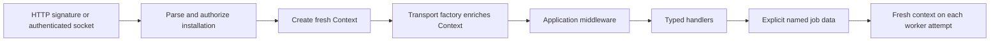

# Transport context factories

Factories populate the existing delivery-local `Thunder\Bolt\Context` using transport input. They run after HTTP signature verification (or Socket Mode's authenticated connection) and installation authorization, and before application middleware. Both the factory and all handlers share the same fresh context for that delivery.

```php
use Thunder\Bolt\BoltConfig;
use Thunder\Bolt\Http\ContextInput as HttpInput;
use Thunder\Bolt\SocketMode\Config as SocketModeConfig;
use Thunder\Bolt\SocketMode\ContextInput as SocketInput;

return new BoltConfig(
    // Usual token/signing secret or OAuth configuration goes here.
    httpContextFactory: function (HttpInput $input) use ($accounts): void {
        $input->delivery->context
            ->set('account', $accounts->forSlackTeam($input->delivery->authorization->teamId))
            ->set('trace', $input->headers['x-request-id'] ?? null);
    },
    socketMode: new SocketModeConfig(
        appToken: $appToken,
        contextFactory: function (SocketInput $input) use ($accounts): void {
            $input->delivery->context
                ->set('account', $accounts->forSlackTeam($input->delivery->authorization->teamId))
                ->set('trace', $input->envelope['envelope_id']);
        },
    ),
);
```

`$accounts` is application-owned persistence. Factories mutate `delivery->context`; they return no replacement context or authorization. Setting a context key named `authorization`, `client` or `token` cannot replace the immutable delivery's authorization, client or typed handler dependencies. Headers have lowercase names and retain scalar/list values; HTTP input also exposes the verified raw body and content type. Socket input exposes the delivery envelope, including retry and envelope information.

Factories are synchronous and execute once for each accepted transport delivery, including retries. Keep enrichment quick and avoid using it for exactly-once side effects. Middleware deduplication may run later. Static token apps only have installation IDs present in their payload/config or obtained with `verifyToken()`; factories do not perform identity lookups automatically. Lifecycle cleanup events can have identity-only authorization without a live credential.



Factory exceptions report `FailureStage::Context` through `App::onError()` with the authorized delivery and transport metadata. They stop dispatch before middleware and handlers, even if the error policy returns `Handled`. HTTP returns an error; Socket Mode sends no acknowledgement for the failed envelope and continues to the next one. A new context is created for that next envelope. Normal receiver error-response policies still apply. Debug output omits raw input values, and serializing factory input throws.

Invalid HTTP signatures, unconfigured authorization, SSL probes, URL verification, ignored self-events, socket control frames and invalid/unsupported envelopes never invoke a delivery factory. Direct trusted `App::dispatch()` calls do not automatically run a transport factory; custom transports can pass an `enrichContext: callable(Delivery): void` as its third argument to run at the same authorized point.

Context remains request-local. Factories do not modify `JobContext`, install credentials or serialize application records into jobs. Pass portable named job arguments explicitly; reload live application records in the worker. This keeps retries/restarts independent of the originating request.

Evidence: `ContextFactoryTest` covers HTTP ordering, authorized typed injection, fresh delivery state, verification/probe/self-event bypass, critical failure reporting, socket envelopes, no acknowledgement on factory failure and clean subsequent dispatch. `JobRequestContextTest` continues to verify fresh worker context.
